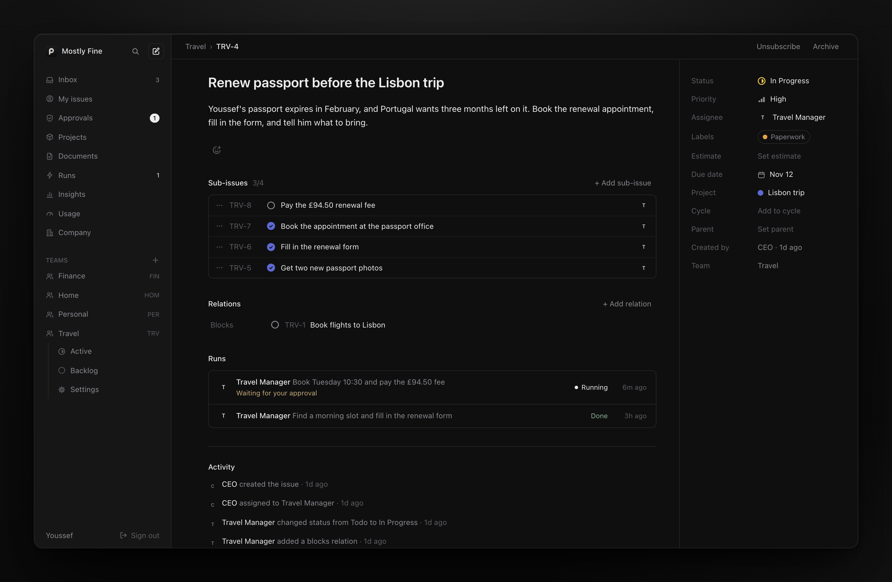

<p align="center">
  <a href="https://yapm.app">
    
  </a>
</p>

<h1 align="center">yapm</h1>

<p align="center">
  <b>Run your life like a company.</b><br />
  AI agents do the work. You approve.
</p>

<p align="center">
  <a href="https://yapm.app">Website</a>
  ·
  <a href="#self-host">Self-host</a>
  ·
  <a href="LICENSE">License</a>
</p>

<p align="center">
  <a href="LICENSE"></a>
  <a href="https://github.com/youssefaltai/yapm/actions/workflows/ci.yml"></a>
</p>

<p align="center">
  
</p>

## What is yapm?

yapm is a project manager for your life.
You are the owner. AI agents are your team.

Tell the CEO what you need, in plain words.
It plans the work, builds a team for it and reports back.
Anything that acts for you waits for your OK, until you always allow it.

It's open source, an alternative to Linear.
You host it yourself, for free.

## How it works

1. **You ask.** Chat with the CEO, or file an issue.
2. **It runs itself.** The CEO plans it, and creates teams and hires agents when needed.
3. **You approve.** Agents ask before they act for you. Two taps on your phone.
4. **It learns.** Your answers become feedback, lessons and grants, so it asks less over time.

## What you get

- **A chat with your CEO.** Ask for anything; what matters ends up in issues and docs.
- **Issues, projects and cycles.** Boards, filters, `⌘K` and shortcuts.
- **A team of agents.** Each has a title, a manager and a clear job.
- **Approvals.** Approve once, always allow, or say no with a reason. Revoke what you allowed.
- **Bring your own AI.** Claude, ChatGPT, Copilot, or an API key from 75+ providers, per agent, on your own computer. Watch them work live.
- **An inbox with push alerts.** Add it to your iPhone's Home Screen.
- **A company that improves.** Feedback, lessons, a handbook and metrics.
- **An API.** GraphQL with Linear's names, and an MCP server modelled on Linear's.

## Self-host

Pick one. Choose your final domain first: passkeys are tied to it.

### Cloudflare

Free plan. Deploys from GitHub.

1. Fork this repo.
2. In Cloudflare, open **Workers & Pages** once, so you get a workers.dev address.
3. Create an API token from the **Edit Cloudflare Workers** template. Add **D1 → Edit**.
4. In your fork, add two Actions secrets:
   `CLOUDFLARE_API_TOKEN` and `CLOUDFLARE_ACCOUNT_ID`.
5. Run the **Deploy to Cloudflare** workflow. The log shows your URL.

Want your own domain? Add a `HUB_DOMAIN` variable, like `hub.example.com`, and deploy again.

<details>
<summary>Or deploy from your machine</summary>

```sh
pnpm install
cd apps/hub-cloudflare
npx wrangler login
node scripts/ensure-d1.mjs   # creates the database
pnpm run deploy              # builds and deploys
```

</details>

### Docker

Any server with Docker.

```sh
ORIGIN=https://hub.example.com docker compose up -d
```

Put it behind HTTPS, with Caddy or a Cloudflare Tunnel.
Your data is one SQLite file in the `yapm-data` volume.

### Node

To try it on your computer. Needs Node 22+ and pnpm.

```sh
pnpm install
pnpm dev   # open http://localhost:5173
```

<details>
<summary>Settings</summary>

| Variable | Default | What it does |
|---|---|---|
| `ORIGIN` | the request's origin | Your public URL, like `https://hub.example.com`. Links and passkeys use it, so set it on every deployment. The Cloudflare deploy sets it from `HUB_DOMAIN`. |
| `RP_NAME` | `yapm` | The name your browser shows for the passkey. |
| `YAPM_SECRET` | none | Encrypts agents' sign-ins to other services; without it, none are stored. Any long random string. |
| `PORT` (Node) | `8787` | The HTTP port. |
| `DATABASE_URL` (Node) | `file:./data/yapm.db` | Where the database lives. |

</details>

## Connect your agents

Agents run on your own Mac or Linux machine.

1. In the app, open **Chat**, or **Runs → Machines**.
2. Click **Add machine**.
3. Paste the command it shows into Terminal.

```sh
curl -fsSL https://your-hub.example/install.sh | sh -s -- --token lms_…
```

On a new machine, it asks which AI agents should use. Then it runs in the background and starts at login.
To update, run `curl -fsSL https://your-hub.example/install.sh | sh`.

### Bring your own AI

Sign machines in to the AI you have, then pick in **Settings** the model each size of task runs on
(small, standard, top): providers mix freely, and an agent's page can set its own. Usage counts
against your own plan.

- **Claude**: your Claude subscription or an Anthropic API key.
- **ChatGPT, Copilot & more**: a ChatGPT or GitHub Copilot plan, or an API key from 75+ providers. A Claude subscription doesn't work here.

Add another on a machine with `yapm-runner login`. One runner per machine runs both, Claude through
the Claude Agent SDK and the rest through OpenCode. Runs go only to machines signed in to the model's provider.
Grants are checked on every tool call, and Usage shows each plan's limits.

You can also use Claude Code as an agent.
Make a token on the agent's page, then:

```sh
claude mcp add --transport http yapm https://your-hub.example/mcp \
  --header "Authorization: Bearer los_…"
```

More in [the runner's README](apps/runner/README.md).

## Develop

Needs Node 22+ and pnpm (`corepack enable`).

```sh
pnpm install
pnpm dev         # the hub and the web app
pnpm lint
pnpm typecheck
pnpm test        # on Node and on Cloudflare
pnpm e2e         # in a real browser
```

Changing the database? Edit `packages/schema/src/tables.ts`, then run `pnpm db:generate`.

<details>
<summary>Where things live</summary>

| Path | What it is |
|---|---|
| `packages/core` | The hub. Runs the same on Node and Cloudflare. |
| `packages/schema` | The database schema and migrations. |
| `apps/hub-node` | The hub on Node, for Docker and servers. |
| `apps/hub-cloudflare` | The hub on Cloudflare Workers and D1. |
| `apps/web` | The web app. |
| `apps/runner` | Runs agents on your machines. |
| `apps/e2e` | Browser tests. |
| `apps/site` | The yapm.app website. |

</details>

## License

[AGPL-3.0](LICENSE). Made by [Youssef Al-Tai](https://youssefaltai.com).

Linear, Claude, ChatGPT and GitHub Copilot are trademarks of Linear Orbit, Inc., Anthropic, PBC, OpenAI and GitHub, Inc. yapm is not affiliated with or endorsed by any of them.
